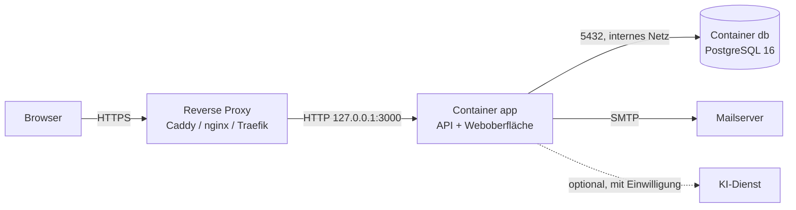

Für den Produktivbetrieb läuft AI_TPI als **ein Container**: Der Node-Server liefert die API **und** die gebaute Weboberfläche aus, führt beim Start die Datenbank-Migrationen aus und läuft als unprivilegierter Nutzer. Die Datenbank ist ein eigener PostgreSQL-Container. Davor gehört ein Reverse Proxy mit HTTPS.



## Voraussetzungen

- Docker Engine 24+ mit Docker Compose v2 (oder Podman mit `podman compose`)
- ein Mailserver (SMTP) für Einladungen und Einmal-Links
- ein DNS-Name und ein Reverse Proxy mit TLS-Zertifikat
- Zugriff auf die Images `node:22-bookworm-slim` und `postgres:16-alpine` (Docker Hub oder ein Firmen-Spiegel, siehe `NODE_IMAGE`/`POSTGRES_IMAGE`)

## 1. Konfiguration anlegen

```bash
cp .env.production.example .env.production
openssl rand -hex 32      # → POSTGRES_PASSWORD
openssl rand -base64 48   # → SECRET_ENCRYPTION_KEY
```

In `.env.production` mindestens `PUBLIC_BASE_URL`, `POSTGRES_PASSWORD`, `SECRET_ENCRYPTION_KEY` und `SMTP_HOST` eintragen. Fehlt einer dieser Werte, bricht `docker compose` mit einer Meldung ab. Alle Variablen: [Konfiguration](/referenz/konfiguration/#container-docker-composeprodyml).

:::caution[SECRET_ENCRYPTION_KEY sicher aufbewahren]
Mit diesem Schlüssel sind SMTP-Passwort und KI-API-Schlüssel in der Datenbank verschlüsselt. Geht er verloren, müssen diese Geheimnisse in der Oberfläche neu eingegeben werden. `.env.production` nie ins Repository einchecken (ist in `.gitignore`).
:::

## 2. Bauen und starten

```bash
docker compose -f docker-compose.prod.yml --env-file .env.production up -d --build
docker compose -f docker-compose.prod.yml --env-file .env.production ps
```

Beim Start wartet `app`, bis die Datenbank bereit ist, führt die Migrationen aus („Migration und Stammdaten: OK“) und startet dann den Server. Der Status wechselt nach einigen Sekunden auf `healthy` (Prüfung von `/api/health` alle 30 Sekunden).

Das Image entsteht in vier Stufen: Abhängigkeiten → Build (Vite für die Oberfläche, esbuild für den Server) → Laufzeit-Abhängigkeiten ohne devDependencies → schlankes Laufzeit-Image. Die Dokumentationsseite und Testwerkzeuge sind nicht enthalten. Originaldokumente (`docs/_quellen/`, `specs/`, `packages/catalog/sources/`) schließt `.dockerignore` aus.

## 3. Ersteinrichtung

Die Ersteinrichtung ist nur über **localhost** erlaubt ([Ersteinrichtung](/handbuch/ersteinrichtung/)). Anfragen vom Host oder Reverse Proxy erreichen den Container aber über das Docker-Netz – die Seite `/einrichtung` bleibt deshalb unsichtbar. Stattdessen im Container:

```bash
docker compose -f docker-compose.prod.yml --env-file .env.production exec app ai-tpi-setup
```

Das Skript fragt Firmenname, Kürzel, Branche (mit Liste), Ihren Namen, die Firmen-E-Mail-Adresse und das Passwort (verdeckt) ab und gibt die Anmeldeadresse `https://…/login/<kürzel>` aus. Es gelten dieselben Regeln wie in der Oberfläche (keine Freemail-Domain, Passwortregeln). Für eine automatisierte Installation lassen sich alle Werte als `SETUP_…`-Variablen übergeben (`exec -e SETUP_COMPANY_NAME=… app ai-tpi-setup`).

Danach in `.env.production` `SETUP_ENABLED=false` setzen und `up -d` erneut ausführen.

## 4. Reverse Proxy

Die Anwendung lauscht nur auf `127.0.0.1:${APP_PORT}` (Standard 3000). Beispiel mit **Caddy** (holt das Zertifikat selbst):

```text
tpi.example.com {
  reverse_proxy 127.0.0.1:3000
}
```

Beispiel mit **nginx** (Ausschnitt; die Live-Aktualisierung nutzt Server-Sent Events, daher ohne Pufferung):

```nginx
location / {
  proxy_pass http://127.0.0.1:3000;
  proxy_set_header Host $host;
  proxy_set_header X-Forwarded-For $proxy_add_x_forwarded_for;
  proxy_set_header X-Forwarded-Proto $scheme;
  proxy_buffering off;
  proxy_read_timeout 1h;
}
```

`TRUST_PROXY=true` (Standard in `docker-compose.prod.yml`) sorgt dafür, dass Rate-Limits und Audit-Log die echte Client-Adresse aus `X-Forwarded-For` verwenden. `COOKIE_SECURE=true` setzt das Sitzungs-Cookie nur über HTTPS und aktiviert HSTS.

## Was der Container absichert

| Maßnahme | Wirkung |
|---|---|
| Nutzer `node` (UID 1000), Code gehört `root` | Der Server kann seinen eigenen Code nicht verändern |
| `read_only: true`, `tmpfs: /tmp` | Dateisystem schreibgeschützt; Daten nur in der Datenbank |
| `cap_drop: ALL`, `no-new-privileges` | Keine Linux-Capabilities, keine Rechteausweitung |
| Port nur an `127.0.0.1` | Erreichbar nur über den Reverse Proxy; die Datenbank gar nicht von außen |
| Content-Security-Policy für die Oberfläche | Skripte und Stile nur vom eigenen Ursprung, keine Inline-Skripte, keine Einbettung in fremde Seiten |
| Ressourcen mit Inhalts-Hash (`/assets/…`) ein Jahr cachebar, `index.html` nie | Updates sind sofort sichtbar, ohne alte Dateien zu mischen |

## Protokolle und Status

```bash
docker compose -f docker-compose.prod.yml logs -f app     # JSON-Protokoll (Cookies, Schlüssel geschwärzt)
docker inspect --format '{{.State.Health.Status}}' ai-tpi-app-1
curl -s http://127.0.0.1:3000/api/health                  # {"status":"ok","db":"up",…}
```

`LOG_LEVEL=debug` liefert mehr Details; Fehlermeldungen beim Start (z. B. fehlender `SECRET_ENCRYPTION_KEY`, Datenbank nicht erreichbar) stehen im Protokoll von `app`.

## Ohne Docker

Der Produktions-Build läuft auch direkt mit Node.js 22:

```bash
npm ci && npm run build
NODE_ENV=production WEB_DIST_DIR=apps/web/dist DATABASE_URL=… SECRET_ENCRYPTION_KEY=… \
  PUBLIC_BASE_URL=https://tpi.example.com npm run db:migrate:prod
NODE_ENV=production WEB_DIST_DIR=apps/web/dist … npm run start
```

`npm run start` braucht kein tsx; der Server ist nach `apps/server/dist/server.mjs` gebündelt. Die Ersteinrichtung funktioniert dann wie gewohnt über `http://localhost:3000/einrichtung` auf dem Server selbst – oder mit `node apps/server/dist/setup-cli.mjs`.
