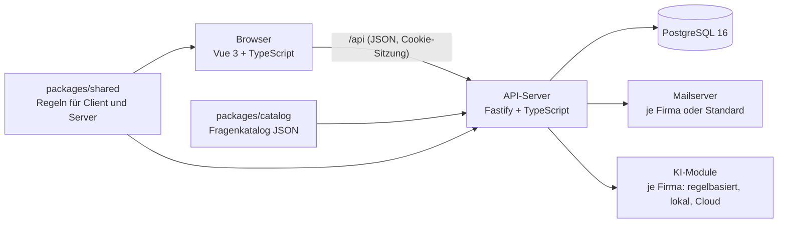

**AI_TPI** ist eine Webanwendung für die **kontinuierliche Verbesserung des Testprozesses**. Fachbereiche mehrerer Firmen und Abteilungen bewerten ihren Testprozess anhand eines Fragenkatalogs, die Ergebnisse werden zusammengeführt, grafisch ausgewertet und durch **KI-gestützte Handlungsempfehlungen** ergänzt.

## Fachliche Grundlage

- **TPI NEXT®** ist das führende Modell: 16 Kernbereiche mit den Reifegraden *Initial*, *Kontrolliert*, *Effizient* und *Optimierend*.
- Ergänzungen aus **Agile TPI** sind in die Kernbereiche eingearbeitet.
- **Drei zusätzliche KI-Kernbereiche** bewerten den Einsatz künstlicher Intelligenz in Qualitätssicherung, Anforderungsprüfung, Testautomatisierung, Entwicklung und Dokumentation.
- Insgesamt: **19 Kernbereiche, 223 Kontrollpunkte**, zweisprachig (Deutsch/Englisch). Details: [Katalog v1 – Übersicht](/projekt/fragenkatalog/katalog-v1-uebersicht/).

## Funktionsumfang

| Bereich | Inhalt | Stand |
|---|---|---|
| Anmeldung | E-Mail + Passwort, Einladung per Mail, Einmal-Link, Sperre nach Fehlversuchen, SSO-fähig vorbereitet | umgesetzt |
| Admin-Bereich | Benutzer, Abteilungen, Firma und Domains, Branchen, andere Firmen, E-Mail, KI-Module, Audit-Log | umgesetzt |
| Mandanten | Mehrere Firmen mit eigener Domain, eigenem Logo und eigener Konfiguration; strikte Datentrennung | umgesetzt |
| Assessments | Stammdaten, Team, Zuweisung der Kernbereiche an Abteilungen, Duplizieren, JSON-Export/-Import | umgesetzt (Phase 5) |
| Fragebogen | Antworten je Abteilung auf allen Geräten, Kommentare mit Autor/Quelle, Live-Aktualisierung und Präsenzanzeige | umgesetzt (Phase 5) |
| Zusammenführung | Assessor führt Abteilungsantworten zusammen (Vorschlag, Begründungspflicht); Änderungshistorie (unveränderbar) | umgesetzt (Phase 5) |
| Bericht | Kennzahlen, Reifegradmatrix, Netz- und Balkendiagramme, KI-Reifegrad, Konsenslücken, Druck/PDF | umgesetzt (Phase 6) |
| Benchmark | Anonymer Vergleich mit Branche und allen Firmen (Median, Quartile, ab 5 Firmen) | umgesetzt (Phase 6) |
| Empfehlungen | Regelbasiert oder mit KI-Modul der Firma, kurzfristig (< 1 Monat) und langfristig (≥ 1 Monat), Datenschutz-Dialog, Maßnahmenplan | umgesetzt (Phase 7) |
| Abschluss | CI/CD, Security-Review, Betriebsdokumentation, Abnahme | geplant (Phase 8) |

## Technischer Aufbau

- **Monorepo** mit npm-Workspaces: `apps/web`, `apps/server`, `apps/docs` (diese Seite), `packages/shared`, `packages/catalog`.
- Alle Regeln (Passwort, E-Mail-Domain, Rollen, Bewertung, Regel-Engine der Empfehlungen) stehen einmal in `packages/shared` und gelten in Browser **und** Server.
- Details: [Architektur](/projekt/architektur/architektur/) und [Projektstruktur](/entwicklung/projektstruktur/).

## Rollen

Jede Person hat **genau eine** Rolle: **Admin**, **Assessor**, **Befragter** oder **Leser**. Was jede Rolle darf, steht unter [Rollen und Rechte](/handbuch/rollen-und-rechte/).
