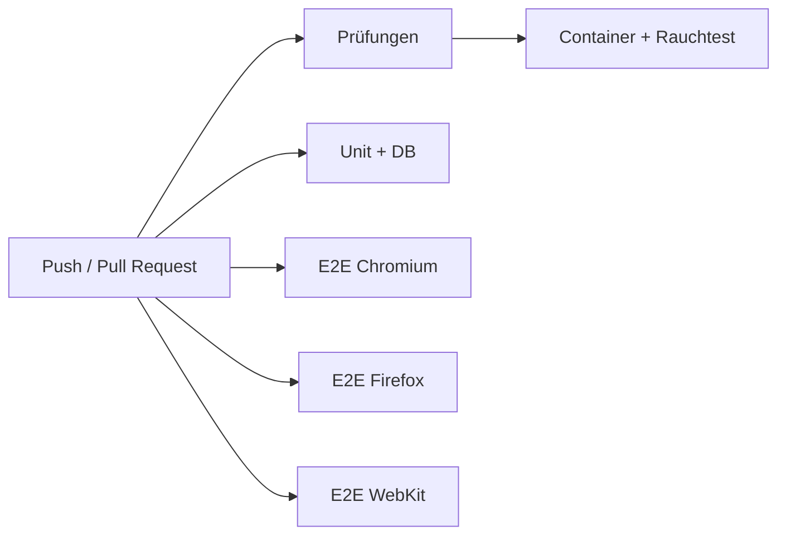

Bei jedem Push auf `main`, bei jedem Pull Request und auf Knopfdruck (`workflow_dispatch`) läuft die Pipeline `.github/workflows/ci.yml` (Entscheidung R-13: GitHub Actions). Ein neuer Push auf denselben Branch bricht den laufenden Durchgang ab.

## Jobs

| Job | Inhalt | lokal nachstellen |
|---|---|---|
| **Prüfungen** | Prettier, ESLint, Typecheck, Fragenkatalog, Testfallkatalog vollständig automatisiert (keine Platzhalter in `tests/e2e/geplant`), `npm audit` (ab „moderate“), Dokumentation bauen | `npm run format:check && npm run lint && npm run typecheck && npm run catalog:validate && npm run test:planned && npm audit --audit-level=moderate && npm run docs:build` |
| **Unit + DB** | Vitest: Unit-, API- und Datenbanktests gegen PostgreSQL 16 (Service-Container) | `TEST_DATABASE_URL=… npm run test:unit` |
| **E2E** (3 Jobs) | Playwright gegen den **Produktions-Build** (`E2E_PROD=1`), aufgeteilt nach Browser-Engine: Chromium (Desktop Chrome, kleiner Laptop, Galaxy S24), Firefox (Desktop), WebKit (Desktop Safari, iPad, iPhone) | `npm run build && E2E_PROD=1 npm run test:e2e` |
| **Container** | Image bauen (mit Build-Cache), Rauchtest, `docker-compose.prod.yml` auf Gültigkeit prüfen | `docker build -t ai-tpi . && tools/docker/smoke-test.sh ai-tpi postgres://…/leere_db` |

Die E2E-Jobs laufen mit `CI=true`: zwei Worker, bis zu zwei Wiederholungen bei Fehlschlag, `test.only` verboten. Bericht und Traces liegen 14 Tage als Artefakt `playwright-report-<engine>` am Durchgang (auch bei Erfolg).

## Rauchtest des Containers

`tools/docker/smoke-test.sh <image> <datenbank-url>` startet das Image gehärtet (read-only, ohne Capabilities) gegen eine **leere** Datenbank und prüft:

1. Migrationen laufen, `/api/health` antwortet
2. der Server läuft nicht als root
3. die Oberfläche wird mit Content-Security-Policy ausgeliefert
4. Ersteinrichtung mit `ai-tpi-setup` und anschließende Anmeldung
5. `docker stop` beendet den Server geordnet (Exit-Code 0)

## Wenn die Pipeline rot ist

| Job | häufige Ursache | Abhilfe |
|---|---|---|
| Prüfungen → Format | Datei nicht mit Prettier formatiert | `npm run format` |
| Prüfungen → Testfallkatalog | neuer Testfall im Katalog ohne Test mit dieser ID im Titel | Test schreiben (ID im Titel, z. B. `TC-ADM-040 …`) |
| Prüfungen → npm audit | neue Sicherheitslücke in einer Abhängigkeit | `npm audit`, Abhängigkeit aktualisieren oder `overrides` in `package.json` |
| E2E | Fehler nur im Produktions-Build (CSP, Auslieferung) | lokal `npm run build && E2E_PROD=1 npm run test:e2e`; Meldungen `CSP-Verstoß: …` nennen Regel, Datei und Zeile |
| E2E | Fehler nur in einer Engine | Artefakt `playwright-report-<engine>` herunterladen, `npx playwright show-report <ordner>` bzw. `show-trace` |
| Container | neue Laufzeitabhängigkeit fehlt im Image | Abhängigkeit in `apps/server/package.json` (nicht nur im Arbeitsbereich) eintragen |

## Nicht enthalten

Die Pipeline baut und prüft das Image, veröffentlicht es aber nicht und verteilt nichts. Zielumgebung ist ein interner Server mit Docker (R-13). Dort wird nach [Installation mit Docker](/betrieb/installation-mit-docker/) aus dem geprüften Stand gebaut. Ein Push in eine Container-Registry (z. B. GitHub Container Registry) und eine automatische Verteilung lassen sich als weiterer Job ergänzen, sobald Registry und Zugang feststehen.
