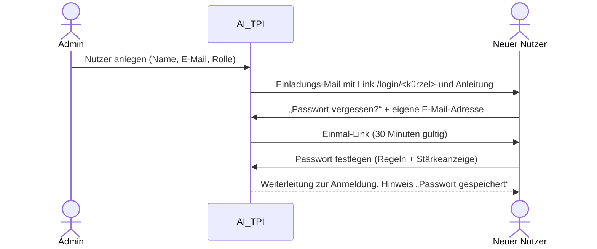

## Anmeldeadresse

Jede Firma hat eine eigene Anmeldeseite mit ihrem Logo: `http(s)://<server>/login/<firmenkürzel>`, z. B. `/login/brunata`. Ein unbekanntes Kürzel zeigt ein neutrales Logo und keine Fehlerseite, damit sich nicht erraten lässt, welche Firmen es gibt.

## Erstes Passwort (Einladung)

Neue Nutzer bekommen **kein** Passwort per Mail. Stattdessen:

Derselbe Weg gilt, wenn jemand sein Passwort vergessen hat.

## Passwortregeln

Während der Eingabe zeigt die Seite jede Regel an und färbt sie **grün**, sobald sie erfüllt ist:

- mindestens **6 Zeichen**
- mindestens **eine Ziffer**
- mindestens **ein Großbuchstabe**
- mindestens **ein Sonderzeichen**

Zusätzlich bewertet eine **Stärkeanzeige** in drei Stufen (*schwach*, *mittel*, *stark*), wie leicht das Passwort zu erraten ist. Dabei werden auch gängige Wörter (Deutsch und Englisch), Tastaturmuster und Ihr Name, Ihre E-Mail-Adresse und Ihre Firma berücksichtigt. Gespeichert werden kann erst ab **mittel**. Ein Beispiel: `Sommer2026!` erfüllt alle Regeln, gilt aber als schwach.

Die Regeln prüft auch der Server. Ein schwaches Passwort wird also selbst dann abgewiesen, wenn jemand die Oberfläche umgeht.

## Einmal-Link

| Eigenschaft | Wert |
|---|---|
| Gültigkeit | 30 Minuten |
| Verwendung | genau einmal |
| Neuer Link | macht ältere Links ungültig |
| Nach dem Speichern | alle Sitzungen des Nutzers werden beendet |

Für bekannte und unbekannte Adressen erscheint dieselbe Bestätigung, damit niemand prüfen kann, welche Adressen registriert sind.

## Anmelden, Sperre, Abmelden

- **Falsches Passwort und unbekannte E-Mail** führen zur gleichen Meldung.
- Nach **5 Fehlversuchen** ist das Konto **15 Minuten** gesperrt.
- **Sitzung:** endet nach **60 Minuten** ohne Aktivität, spätestens nach **12 Stunden**. Danach führt die nächste Aktion zur Anmeldeseite mit dem Hinweis *Ihre Sitzung ist abgelaufen*; nach der Anmeldung geht es zur vorherigen Seite zurück.
- **Abmelden** (oben rechts) beendet die Sitzung sofort.
- Wer eine geschützte Seite ohne Anmeldung aufruft, landet auf der Anmeldung und danach wieder auf der gewünschten Seite.

## Passwort durch Admin zurücksetzen

Ein Admin kann das Passwort jeder Person seiner Firma zurücksetzen (Schaltfläche **Passwort zurücksetzen**). Das alte Passwort ist dann **sofort ungültig**, alle Sitzungen werden beendet und die Person erhält einen neuen Einmal-Link. Der Admin sieht das Passwort zu keinem Zeitpunkt. Zum Zurücksetzen für Personen **anderer** Firmen siehe [Andere Firmen](/handbuch/andere-firmen/#passwort-für-nutzer-einer-anderen-firma).
