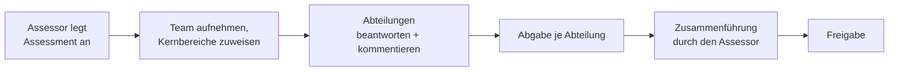

Ein **Assessment** ist eine Bewertung des Testprozesses mit dem Fragenkatalog (TPI NEXT, agile Ergänzungen, KI-Kernbereiche). Mehrere Abteilungen beantworten die Kontrollpunkte **getrennt**. Der Assessor führt die Antworten anschließend zu einer **konsolidierten Antwort** je Kontrollpunkt zusammen; nur diese zählt für Bericht, Benchmark und Empfehlungen.

## Wer darf was?

| Aktion | Admin | Assessor | Befragter | Leser |
|---|:-:|:-:|:-:|:-:|
| Assessment anlegen, Stammdaten ändern, löschen | – | ✔ | – | – |
| Team aufnehmen, Kernbereiche zuweisen, Quellen pflegen | – | ✔ | – | – |
| Antworten der **eigenen Abteilung** erfassen | – | ✔¹ | ✔ | – |
| Kommentieren | – | ✔ | ✔² | – |
| Zusammenführen, Status ändern | – | ✔ | – | – |
| Antworten aller Abteilungen und Zusammenführung lesen | ✔ | ✔ | – | ✔ |
| Änderungshistorie lesen | ✔ | ✔ | ✔ | ✔ |

¹ nur mit Abteilung und wenn der Kernbereich dieser Abteilung zugewiesen ist. ² nur in den Kernbereichen der eigenen Abteilung.

Assessments sind nur für ihre **Team-Mitglieder** sichtbar. Admins sehen alle Assessments der eigenen Firma, aber nur lesend. Wer nicht zum Team gehört, bekommt „Sie gehören nicht zum Team dieses Assessments“.

## Assessment anlegen

1. **Assessments** in der Kopfzeile → **Neues Assessment** (nur Assessoren).
2. Stammdaten wie im Excel-Blatt „Information“ ausfüllen. Pflicht sind **Projekt**, **Assessor** und **Startdatum**. Das Enddatum darf nicht vor dem Startdatum liegen; die Anzahl der Interviews ist eine ganze Zahl ab 0.
3. **Vorgehensmodell:** *agil* zeigt alle Kontrollpunkte, *klassisch* blendet die agilen Kontrollpunkte aus. Mit dem Häkchen für **KI** werden die KI-Kernbereiche KB17–KB19 und die KI-Kontrollpunkte einbezogen.
4. **Neues Assessment** speichert. Wer anlegt, ist automatisch im Team.

## Team und Zuweisung

Reiter **Team und Zuweisung** im Assessment:

- **Team:** Personen der eigenen Firma aufnehmen (Assessoren, Befragte, Leser). Admins brauchen keine Aufnahme.
- **Kernbereiche zuweisen:** Je Kernbereich die Abteilungen anhaken, die antworten sollen. Ein Kernbereich kann **mehreren** Abteilungen zugewiesen sein; jede antwortet für sich.
- **Abgaben:** Zeigt je Abteilung „in Bearbeitung“ oder „abgegeben“. Der Assessor kann eine Abgabe **wieder öffnen**.

:::tip
Befragte brauchen eine **Abteilung**. Die Abteilung vergibt ein Admin unter *Admin-Bereich → Benutzer*.
:::

## Fragebogen beantworten

**Fragebogen** im Assessment öffnen.

- Links (auf dem Smartphone oben) stehen die Kernbereiche mit Fortschritt. **Meine Kernbereiche** zeigt nur die der eigenen Abteilung.
- Je Kontrollpunkt eine Antwort wählen: **Erfüllt**, **Teilweise**, **Nicht erfüllt** oder **Nicht anwendbar**. Ein zweiter Klick auf die gewählte Antwort setzt sie wieder auf „offen“.
- Jede Auswahl wird **sofort gespeichert** („✓ gespeichert“). Ohne Verbindung erscheint „Nicht gespeichert“ mit **Erneut versuchen**.
- **Tastatur:** Mit Tab zur Antwortgruppe, mit den Pfeiltasten die Antwort wählen.
- **Filter:** „Nur offene“ sowie klassisch / agil / KI. Kontrollpunkte mit KI-Bezug tragen das Kennzeichen **KI**, agile das Kennzeichen **agil**.
- **‹ ›** oder Wischen (Smartphone) wechseln den Kernbereich.

### Gleichzeitiges Bearbeiten

- **Live:** Antworten der eigenen Abteilung und neue Kommentare erscheinen bei allen, die den Fragebogen geöffnet haben, **ohne Neuladen** (in der Regel nach weniger als einer Sekunde). Zusammenführung und Assessment-Seite aktualisieren sich ebenso.
- **Wer ist gerade wo?** Über dem Kernbereich steht z. B. „Eva Entwicklung bearbeitet gerade KB03.“, in der Kernbereichsliste zeigt 👤 an, wie viele Kolleginnen und Kollegen dort gerade sind. Wer die Seite schließt, verschwindet aus der Anzeige.
- **Konflikt:** Ändern zwei Personen derselben Abteilung denselben Kontrollpunkt so gleichzeitig, dass die Live-Aktualisierung zu spät kommt, wird nichts überschrieben. Es erscheint ein Hinweis mit dem aktuellen Stand und zwei Möglichkeiten: **Meine Auswahl trotzdem speichern** oder **Aktuellen Stand übernehmen**.
- Schnelles Durchklicken oder Pfeiltasten sind kein Problem: Die Antworten eines Kontrollpunkts werden nacheinander gespeichert.

### Abgeben

**Abteilung abgeben** am Ende des Fragebogens. Danach sind die Antworten der Abteilung gesperrt, bis der Assessor die Abgabe wieder öffnet.

## Kommentare und Quellen

- **💬 Kommentare** unter jedem Kontrollpunkt öffnen. Verfasser und Zeitpunkt werden automatisch gespeichert; eine **Quelle** (z. B. Interviewpartner, Dokument) ist optional.
- Höchstens **2000 Zeichen**; ein Zähler zeigt den Stand. Leere Kommentare werden nicht gespeichert. Eingaben werden immer als Text angezeigt, nie als HTML.
- **Bearbeiten** kann nur, wer den Kommentar geschrieben hat. **Löschen** dürfen der Verfasser und der Assessor.
- **Quellen** pflegt der Assessor im Reiter *Quellen* (Name, Rolle, Einheit, Art). Gleicher Name mit gleicher Rolle ist nicht doppelt möglich. Eine Quelle, die in Kommentaren steckt, lässt sich nicht löschen, nur **deaktivieren**; sie ist dann nicht mehr wählbar, alte Kommentare behalten sie.

## Zusammenführung

**Zusammenführung** im Assessment (Assessor; Leser und Admin nur lesend).

Je Kontrollpunkt stehen die Antworten aller zugewiesenen Abteilungen mit ihren Kommentaren, dazu ein **Vorschlag**:

| Antworten der Abteilungen | Vorschlag |
|---|---|
| alle gleich | diese Antwort |
| „Erfüllt“ und „Nicht erfüllt“ gemischt | Teilweise |
| „Erfüllt“ und „Teilweise“ | Teilweise |
| „Teilweise“ und „Nicht erfüllt“ | Nicht erfüllt |
| nur „Nicht anwendbar“ | Nicht anwendbar (sonst zählt „n. a.“ nicht mit) |
| noch keine Antwort | offen |

Weicht die festgelegte Antwort vom Vorschlag ab oder sind die Abteilungen **uneinig**, ist eine **Begründung Pflicht**. Filter: „Nur uneinige“ und „Nur nicht festgelegte“.

## Duplizieren, Export und Import

| Funktion | Wo | Was passiert |
|---|---|---|
| **Duplizieren** | Assessment → Überblick (Assessor) | Neues Assessment mit eigenem Namen und Status „Erfassung“; übernommen werden Stammdaten, Team, Zuweisungen, Quellen, Antworten, Kommentare und Zusammenführung. Gut als Ausgangspunkt für die Folgebewertung im nächsten Jahr. |
| **Als JSON exportieren** | Assessment → Überblick (alle mit Zugriff) | Lädt eine Datei `assessment-<Projekt>.json` herunter – zum Archivieren oder für eine andere Installation. |
| **JSON importieren** | Assessments → *JSON importieren* (Assessor) | Legt nach Rückfrage ein **neues** Assessment an; bestehende werden nie überschrieben. |

Beim Import werden Abteilungen über ihren **Namen**, Personen über ihre **E-Mail-Adresse** zugeordnet. Was es in der eigenen Firma nicht gibt (Abteilung, Person, Kontrollpunkt, Kernbereich), wird übersprungen und nach dem Import aufgelistet; Antworten und Kommentare unbekannter Personen werden der importierenden Person zugeordnet. Abgewiesen werden Dateien ohne gültiges JSON, Dateien, die keine AI_TPI-Exportdatei sind, und unbekannte Formatversionen.

## Status

| Status | Bedeutung |
|---|---|
| **Erfassung** | Abteilungen beantworten und kommentieren. |
| **Zusammenführung** | Antworten sind gesperrt; der Assessor legt die konsolidierten Antworten fest. „Erfassung wieder öffnen“ ist möglich. |
| **Freigegeben** | Ergebnis steht fest; nur der Assessor kann über „Zur Zusammenführung“ noch etwas ändern, jede Änderung wird protokolliert. |

## Änderungshistorie

Jede Änderung an Antworten, konsolidierten Antworten, Kommentaren, Quellen, Team, Zuweisung, Status und Stammdaten wird mit Zeitpunkt, Person, Rolle, Abteilung, altem und neuem Wert protokolliert. Die Einträge lassen sich **weder ändern noch löschen**, auch nicht in der Datenbank.

- Alle Rollen öffnen sie über **Änderungshistorie** in der Kopfzeile (Admins: *Admin-Bereich → Änderungshistorie*). Nicht-Admins sehen dort nur diesen einen Reiter.
- Filter: Assessment, Kernbereich, Kontrollpunkt, Person, Abteilung, Zeitraum; **CSV exportieren** für die Ablage.
- **Verlauf anzeigen** am Kontrollpunkt springt direkt zu dessen Einträgen.
- Sichtbar ist nur die eigene Firma; Nicht-Admins sehen nur Assessments, in deren Team sie sind. Wird ein Assessment gelöscht, bleibt seine Historie erhalten.

:::caution[Datenschutz]
Auch Leser sehen in der Historie, **wer** was geändert hat. Das sollte vor dem Einsatz mit Betriebsrat und Datenschutz abgestimmt sein (offene Frage R-12).
:::
