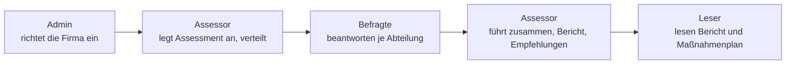

AI_TPI kennt vier Rollen. Jede Person hat genau eine davon; sie vergibt der Admin Ihrer Firma. Nur Admins sehen in der Kopfzeile den Punkt **Admin**. Diese Seite zeigt je Rolle den kürzesten Weg zum Ziel. Was jede Rolle genau darf, steht unter [Rollen und Rechte](/handbuch/rollen-und-rechte/).

## Anmelden

Sie erhalten eine **Einladung per E-Mail** mit der **Anmeldeadresse Ihrer Firma** (`…/login/<firmenkürzel>`) – am besten als Lesezeichen speichern. Ein Passwort steht nicht in der Mail: Auf der Anmeldeseite **„Passwort vergessen?“** wählen und Ihre E-Mail-Adresse eingeben; der Einmal-Link führt zum Festlegen des eigenen Passworts. Genauso funktioniert es, wenn Sie Ihr Passwort später vergessen. Nach 5 Fehlversuchen ist das Konto 15 Minuten gesperrt. Details: [Anmeldung und Passwort](/handbuch/anmeldung-und-passwort/).

## Admin

1. **Firma vervollständigen** – *Admin-Bereich → Meine Firma*: zugelassene E-Mail-Domains, Branche, Logo. → [Meine Firma und Branchen](/handbuch/meine-firma-und-branchen/)
2. **E-Mail einrichten** – *Admin-Bereich → E-Mail*: SMTP-Zugang speichern, dann **Test-Mail an mich senden**. Ohne funktionierende Mail kommen keine Einladungen an. → [E-Mail und KI-Module](/handbuch/e-mail-und-ki/)
3. **Abteilungen anlegen** – *Admin-Bereich → Abteilungen*: die Einheiten, die später getrennt antworten (z. B. „Test“, „Entwicklung“, „Betrieb“). → [Benutzer und Abteilungen](/handbuch/benutzer-und-abteilungen/#abteilungen)
4. **Benutzer einladen** – *Admin-Bereich → Benutzer → Benutzer anlegen*, mit Rolle und (für Befragte) Abteilung. Mindestens einen **Assessor** anlegen. Tipp: einen **zweiten Admin** anlegen, damit die Firma bei Urlaub oder vergessenem Passwort handlungsfähig bleibt.
5. **Optional: KI-Modul** – *Admin-Bereich → KI-Konfiguration*: für KI-gestützte Empfehlungen ein Modul anlegen, testen und als Standard festlegen.

Als Admin sehen Sie alle Assessments, Berichte und Empfehlungen Ihrer Firma, ändern sie aber nicht.

## Assessor

1. **Assessment anlegen** – *Assessments → Neues Assessment*: Projekt, Assessor, Startdatum; Vorgehensmodell (agil/klassisch) und ob die KI-Kernbereiche dazugehören. → [Assessment anlegen](/handbuch/assessments-und-fragebogen/#assessment-anlegen)
2. **Team und Zuweisung** – Befragte und Leser ins Team aufnehmen und je Kernbereich die antwortenden Abteilungen anhaken.
3. **Fortschritt verfolgen** – im Reiter *Team und Zuweisung* sehen Sie je Abteilung „in Bearbeitung“ oder „abgegeben“.
4. **Zusammenführen** – je Kontrollpunkt aus den Antworten der Abteilungen die gültige Antwort festlegen; bei Abweichung vom Vorschlag mit Begründung. → [Zusammenführung](/handbuch/assessments-und-fragebogen/#zusammenführung)
5. **Bericht** – Reifegrad je Kernbereich, Diagramme, Vergleich mit Branche; drucken oder als PDF. → [Bericht und Benchmark](/handbuch/bericht-und-benchmark/)
6. **Empfehlungen** – erzeugen (regelbasiert oder mit KI, nach Einwilligung), dann im Maßnahmenplan Status, Verantwortliche und Termine pflegen; Export als CSV. → [Handlungsempfehlungen](/handbuch/empfehlungen/)

## Befragte

1. Unter **Assessments** das Assessment öffnen, zu dem Sie eingeladen wurden → **Fragebogen**.
2. **Meine Kernbereiche** zeigt nur die Bereiche Ihrer Abteilung. Je Kontrollpunkt **Erfüllt**, **Teilweise**, **Nicht erfüllt** oder **Nicht anwendbar** wählen – jede Auswahl wird sofort gespeichert.
3. Begründungen und Rückfragen als **Kommentar** am Kontrollpunkt hinterlassen.
4. Sind alle Bereiche beantwortet: **Abteilung abgeben**. Danach sind die Antworten gesperrt; der Assessor kann die Abgabe wieder öffnen.

Arbeiten mehrere Personen gleichzeitig, zeigt der Fragebogen, wer gerade im selben Kernbereich ist; Änderungen der anderen erscheinen ohne Neuladen. → [Fragebogen beantworten](/handbuch/assessments-und-fragebogen/#fragebogen-beantworten)

## Leser

Unter **Assessments** die Assessments, in deren Team Sie sind: **Bericht**, **Empfehlungen** (Maßnahmenplan, CSV-Export) und die **Änderungshistorie** (Kopfzeile) lesen. Unter **Benchmark** der anonyme Vergleich mit anderen Firmen der Branche. Bearbeiten können Leser nichts; Versuche werden mit „Keine Berechtigung“ und dem Grund beantwortet.

## Hilfe bei Problemen

- Meldungen und ihre Ursachen: [Fehlerbehebung](/handbuch/fehlerbehebung/)
- Keine Einladung erhalten, Konto gesperrt, falsche Rolle oder Abteilung: an den **Admin Ihrer Firma** wenden.
- Anwendung nicht erreichbar: an den **Betrieb** wenden (Hinweise für Betreiber unter [Betrieb](/betrieb/installation-mit-docker/)).
