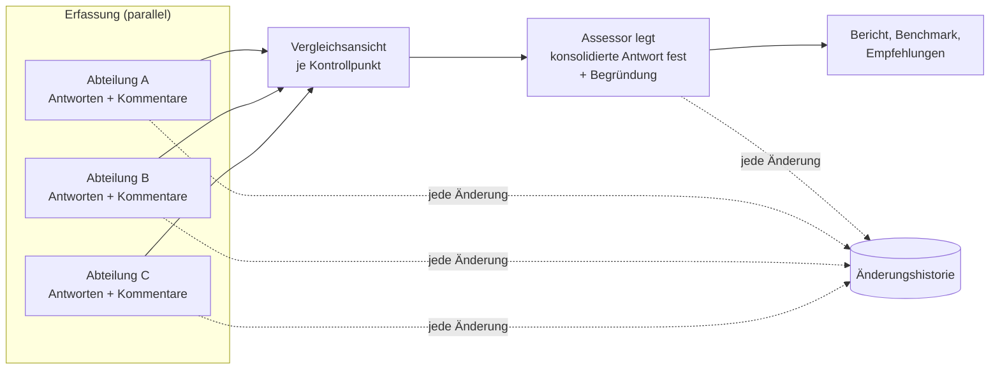

# Zusammenführung der Abteilungsantworten und Änderungshistorie

Grundlage: Antwort zu N-03 (09.11.2026).

## 1. Ablauf



## 2. Regeln

| Aspekt | Regel |
|---|---|
| Erfassung | Jede Abteilung erfasst eine **eigene Antwort** je Kontrollpunkt (`department_answer`). Mehrere Personen derselben Abteilung bearbeiten dieselbe Abteilungsantwort, mit Konflikterkennung. |
| Vorschlag | Das System schlägt je KP eine konsolidierte Antwort vor (Standard: **die strengere Bewertung**, Vorschlag R-11), z. B. „Erfüllt“ + „Nicht erfüllt“ → „Teilweise“. Bei gleichen Antworten wird automatisch übernommen. |
| Entscheidung | Der **Assessor** legt die konsolidierte Antwort fest (`consolidated_answer`). Bei Abweichung vom Vorschlag oder bei uneinigen Abteilungen ist eine **Begründung Pflicht**. |
| Bericht | Basis für Wertung, Benchmark und Empfehlungen ist **ausschließlich** die konsolidierte Antwort. Nicht konsolidierte KP gelten als „offen“. |
| Abweichungen | Der Bericht weist KP mit uneinigen Abteilungen als eigene Auswertung aus („Konsenslücken“). Das ist ein Indikator für Kommunikationsprobleme (KB05). |
| Status | Abteilung: *in Bearbeitung → abgegeben*. Assessment: *Erfassung → Zusammenführung → freigegeben*. Nach der Freigabe sind Änderungen nur durch den Assessor möglich und werden protokolliert. |

## 3. Vergleichsansicht (Assessor)

```
KB03.K.02  Die Teststrategie basiert auf einer Produktrisikoanalyse.
┌───────────────┬──────────────┬─────────────────────────────┐
│ Abteilung     │ Antwort      │ Kommentar (Verfasser)       │
├───────────────┼──────────────┼─────────────────────────────┤
│ Entwicklung   │ ✔ Erfüllt    │ „Risk Poker im Refinement“  │
│ Fachbereich   │ ✖ Nein       │ „Kein Dokument bekannt“     │
│ Betrieb       │ – n. a.      │                             │
├───────────────┴──────────────┴─────────────────────────────┤
│ Vorschlag: ◐ Teilweise   Konsolidiert: [ ◐ Teilweise ▼ ]    │
│ Begründung*: [ Risikoanalyse findet statt, ist aber nicht ] │
│              [ dokumentiert.                              ] │
└────────────────────────────────────────────────────────────┘
```

## 4. Änderungshistorie

- **Protokolliert werden:** Abteilungsantworten, konsolidierte Antworten inkl. Begründung, Kommentare (anlegen, ändern, löschen), Statuswechsel, Zuweisungen, Stammdaten des Assessments, übernommene oder abgelehnte Empfehlungen.
- **Je Eintrag:** Zeitstempel, Nutzer (Name, Rolle, Abteilung), Objekt (z. B. KP-ID), Aktion, alter Wert, neuer Wert, ggf. Begründung.
- **Unveränderbar:** Einträge können nicht bearbeitet oder gelöscht werden; die Tabelle ist append-only.
- **Einsicht:** Über den Admin-Bereich, Reiter „Änderungshistorie“, für **alle Rollen** (Admin, Assessor, Befragter, Leser), jeweils nur für die eigene Firma. Filterbar nach Assessment, Kernbereich, KP, Nutzer, Abteilung und Zeitraum; Export als CSV.
- Direkt am Kontrollpunkt gibt es zusätzlich einen Link „Verlauf anzeigen“.
- **Admins (S-12, S-11):** sehen die Historie ihrer **eigenen** Firma; Aktionen von Admins anderer Firmen (Admin angelegt, herabgestuft, Passwort zurückgesetzt) erscheinen dort als Verwaltungsereignisse. Inhalte anderer Firmen sind nie sichtbar.
- **Datenschutz:** Weil auch Leser die Historie mit Namen sehen, ist zu prüfen, ob dies mit Betriebsrat und Datenschutz abgestimmt ist (R-12).
