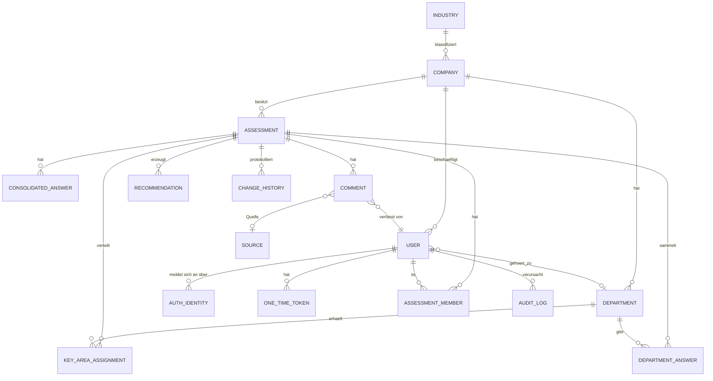

# Datenmodell (Version 3 – Mandanten, Abteilungsantworten, Historie)

## Tabellen

| Tabelle | Wichtige Felder |
|---|---|
| `industry` | id, code (z. B. `BNK`), nameDe, nameEn, naceRef, active |
| `company` | id, name, slug (Login-URL), logoUrl / logoFile, logoAlt, industryId, benchmarkOptIn, active, createdByUserId, createdAt |
| `company_domain` | companyId, domain (eindeutig über alle Firmen, lowercase) |
| `blocked_domain` | domain (Freemail-Sperrliste, pflegbar) |
| `user` | id, companyId, departmentId?, name, email (eindeutig, case-insensitive), **role** (`admin` / `assessor` / `respondent` / `reader`, genau eine), status (`invited` / `active` / `inactive` / `deleted`), **isExternal** (aus Präfix `ext.` abgeleitet), **createdByUserId** (für „Von mir angelegte Admins“), passwordHash, mustChangePassword, failedLogins, lockedUntil, lastLoginAt |
| `auth_identity` | userId, provider (`local` / `oidc:…`), externalId – SSO-Vorbereitung |
| `one_time_token` | userId, purpose (`password_set` / `email_change`), tokenHash, expiresAt, usedAt |
| `setup_state` | initialized (bool), initializedAt, initializedFromIp – Ersteinrichtung erster Admin |
| `department` | id, companyId, name, active |
| `assessment` | id, companyId, Stammdaten (wie Excel „Information“), catalogVersion, methodFilter, status (`collecting` / `consolidating` / `released`), releasedAt |
| `assessment_member` | assessmentId, userId (Zuordnung von Nutzern zu Assessments; Rechte ergeben sich aus der Rolle) |
| `key_area_assignment` | assessmentId, keyAreaId, departmentId |
| `department_answer` | assessmentId, departmentId, checkpointId, value, status (`draft` / `submitted`), version, updatedBy, updatedAt |
| `consolidated_answer` | assessmentId, checkpointId, value, suggestedValue, rationale, consolidatedBy, consolidatedAt, version |
| `source` | assessmentId, name, role, unit, type, active |
| `comment` | id, assessmentId, checkpointId, departmentId?, text, authorUserId, sourceId?, evidence, lang, createdAt, updatedAt |
| `recommendation` | assessmentId, checkpointIds, horizon, effort, priority, title, text, origin (`rule` / `ai`), aiProvider, aiModel, benchmarkGap, status, ownerUserId, dueDate |
| `benchmark_snapshot` | assessmentId, companyId, industryId, catalogVersion, Kennzahlen je KB (JSON), createdAt – wird bei der Freigabe erzeugt |
| `change_history` | id, companyId, assessmentId, entityType, entityId, checkpointId?, action, oldValue, newValue, rationale?, userId, userNameSnapshot, departmentSnapshot, createdAt – **append-only** |
| `app_setting` | Betreiber-Branding (neutrales Logo für `/login`), Passwortrichtlinie (global) |
| `mail_config` | **companyId** (eindeutig), transport (`sendmail` / `smtp`), host, port, tls, user, passwordEncrypted, fromAddress, lastTestOkAt |
| `ai_config` | **companyId**, name (z. B. „Claude Produktion“), mode, provider, baseUrl, model, apiKeyEncrypted, temperature, maxTokens, timeoutSec, sendComments, pseudonymize, promptTemplate, isDefault – mehrere auswählbare KI-Module je Firma möglich |
| `audit_log` | userId, companyId (des Ausführenden), targetCompanyId, action, entity, entityId, details, ip, createdAt |
| `notification` | recipientUserId, type (`cross_company_change` / `admin_created` / `admin_deleted` / `password_reset`), payload, sentAt, mailStatus |

## Validierungsregeln (Grundlage für Negativtests)
- Jeder Zugriff wird auf `companyId` des Nutzers eingeschränkt; fremde IDs liefern **404** (nicht 403), damit ihre Existenz nicht verraten wird.
- Genau eine Rolle je Nutzer; der letzte aktive Admin **je Firma** ist geschützt.
- `user.email`-Domain muss in `company_domain` der Firma des Nutzers enthalten sein (Prüfung bei Anlage und Änderung).
- Admin-Endpunkte wirken nur auf die eigene `companyId`; Ausnahmen: `POST /admin/companies` (neue Firma + Admin), `POST /admin/companies/:id/admins` (Admin für bestehende Firma) und `PATCH /admin/created-admins/:userId` (nur für Nutzer mit `createdByUserId` = eigener Nutzer; nur Rolle und Aktiv-Status änderbar).
- Abteilungsantwort nur durch Mitglieder der Abteilung bei zugewiesenem Kernbereich; Version muss passen (sonst 409).
- Konsolidierte Antwort nur durch Assessoren; Begründung Pflicht bei Abweichung vom Vorschlag bzw. bei uneinigen Abteilungen.
- Admin: **Lesezugriff** auf Antworten, Kommentare, Berichte und Empfehlungen der **eigenen** Firma; kein Schreibzugriff darauf (403) (S-11). Fremde Firmen: nur Benchmark-Aggregate.
- Firmenübergreifender Passwort-Reset: `POST /admin/password-resets { email }` – wirkt für jede Firma, liefert immer dieselbe Antwort, löst Benachrichtigung an die Admins der Zielfirma aus (S-10).
- Leser: ausschließlich lesende Endpunkte. Befragte: nur Antworten/Kommentare ihrer Abteilung. Zusammenführung: nur Assessoren.
- `change_history` hat keine Update- oder Delete-Endpunkte; die Datenbankrechte erlauben nur INSERT.

## Ergänzung Phase 4b (Migration `0002_company_config`)

| Tabelle | Zweck | Wichtige Felder |
|---|---|---|
| `company_mail_config` | Mailserver je Firma (S-04) | `transport` (`system` \| `smtp`), `host`, `port`, `secure`, `username`, `password_enc` (verschlüsselt), `from_address` |
| `ai_module` | KI-Module je Firma (S-04, S-09) | `mode` (`rules` \| `local` \| `cloud`), `provider`, `base_url`, `model`, `api_key_enc` (verschlüsselt), `temperature`, `max_tokens`, `timeout_sec`, `send_comments`, `pseudonymize`, `prompt_template`, `is_default`; Name je Firma eindeutig |
| `department` | zusätzlich eindeutiger Name je Firma (ohne Groß-/Kleinschreibung) | – |
| `audit_log` | zusätzliche Indizes für Firmenansicht und Tageslimit | `(company_id, created_at)`, `(target_company_id, created_at)`, `(user_id, action, created_at)` |

## Ergänzung Phase 5 (Migration `0003_assessments`)

| Tabelle | Zweck | Wichtige Felder |
|---|---|---|
| `assessment` | Assessment je Firma | Stammdaten (`project`, `assessor_name`, `domain`, `organization_unit`, `main_stakeholder`, `contact`, `assessment_type`, `start_date`, `end_date`, `interview_count`, `scope`), `method_model` (`classic` \| `agile`), `include_ai`, `catalog_version`, `status` (`collecting` \| `consolidating` \| `released`), `released_at` |
| `assessment_member` | Team | `(assessment_id, user_id)` |
| `key_area_assignment` | Kernbereich → Abteilungen | `(assessment_id, key_area_id, department_id)`; mehrere Abteilungen je KB möglich |
| `department_answer` | Antwort je Abteilung und KP | `value` (`yes` \| `partial` \| `no` \| `na`; „offen“ = keine Zeile), `version` (optimistisches Sperren), `updated_by_user_id` |
| `department_submission` | Abgabe einer Abteilung | `(assessment_id, department_id)`, `submitted_at` |
| `consolidated_answer` | festgelegte Antwort je KP | `value`, `suggested_value`, `rationale`, `version` |
| `source` | Quellen/Autoren je Assessment | `name`, `role`, `unit`, `type`, `active`; eindeutig je Assessment über `lower(name)` + `lower(role)` |
| `comment` | Kommentar je KP | `author_user_id`, `department_id`, `source_id`, `text` (≤ 2000), `updated_at` |
| `change_history` | Änderungshistorie | ohne Fremdschlüssel auf `assessment` (überdauert das Löschen), Schnappschüsse von Name, Rolle, Abteilung und Assessment; Trigger `change_history_no_update_delete` weist `UPDATE`/`DELETE` ab |

**Rechte (umgesetzt in `apps/server/src/assessment/access.ts`):** Fremde Firma → 404; eigene Firma ohne Mitgliedschaft → 403 (Admins: Lesezugriff); Antworten nur Befragte bzw. Assessoren mit Abteilung in zugewiesenen Kernbereichen; Zusammenführung nur Assessoren; Befragte sehen nur die Antworten der eigenen Abteilung.
