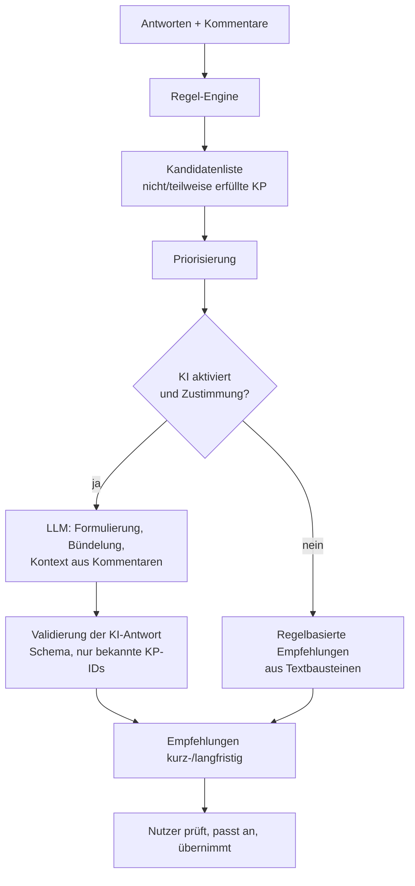

# KI-gestützte Handlungsempfehlungen – Konzept

## 1. Zweistufiges Verfahren

## 1a. Auswahl des KI-Moduls (S-09)
Beim Erzeugen der Empfehlungen wählt der **Assessor oder Admin** eines der für die Firma konfigurierten KI-Module; das Standardmodul ist vorbelegt. Das gewählte Modul und Modell werden an jeder Empfehlung gespeichert.

## 2. Regel-Engine (deterministisch, testbar)

**Kandidaten:** alle KP mit `no` oder `partial` in Kernbereichen im Scope.

**Priorität** (absteigend), angelehnt an TPI NEXT® und Agile-TPI-Cluster:
1. KP der **nächsthöheren, noch nicht erreichten Ebene** des jeweiligen KB (erst Fundament).
2. Niedriger **Cluster**-Buchstabe (A vor B …), falls vorhanden.
3. KP, von denen andere KP abhängen (`dependsOn`).
4. KB mit niedrigstem Erfüllungsgrad bzw. größtem Abstand zum **Branchen-Median** (Benchmark).
5. Geringerer Aufwand zuerst (Quick Wins).

**Zeithorizont:**
| Aufwand des KP | Horizont |
|---|---|
| `S` | **kurzfristig** (< 1 Monat) |
| `M`, `L` | **langfristig** (≥ 1 Monat) |
| `partial` mit `M` | kurzfristig „ersten Schritt“ + langfristig „vollständige Umsetzung“ (aufgeteilt) |

Begrenzung: z. B. max. 10 kurzfristige und 10 langfristige Empfehlungen, verwandte KP desselben KB werden gebündelt.

## 3. KI-Stufe

- **Eingabe (Prompt-Kontext):** Kandidaten (ID, Text, Ebene, Aufwand, Horizont), KB-Erfüllungsgrade, ggf. pseudonymisierte Kommentare, Projektkontext (Domäne, agil/klassisch), Sprache.
- **Auftrag:** Empfehlungen konkretisieren, bündeln, mit nächstem Schritt, erwartetem Nutzen, Messgröße und Verantwortlichenrolle versehen; Horizont der Regel-Engine beibehalten oder begründet ändern.
- **Ausgabe:** striktes JSON gemäß Schema `Recommendation`; Antworten mit unbekannten KP-IDs oder fehlerhaftem JSON werden verworfen → Fallback auf Regel-Engine.
- **Transparenz:** Kennzeichnung „KI-generiert (Modell, Datum)“, Original-Regeltext einsehbar.
- **Datenschutz:** Vor dem Senden Dialog mit Vorschau der übertragenen Daten.

## 4. Beispiel (Ziel-Ausgabe)

| Horizont | Empfehlung | Bezug | Nutzen |
|---|---|---|---|
| kurzfristig | Produktrisikoanalyse im nächsten Refinement als 30-min-Risk-Poker einführen; Ergebnis im Backlog dokumentieren. | KB03.K.02 | Testaufwand wird risikoorientiert verteilt |
| kurzfristig | KI-Richtlinie (1 Seite) mit zugelassenen Tools und verbotenen Datenklassen veröffentlichen. | KB17.K.01, KB17.K.03 | Rechtssicherheit, Datenschutz |
| langfristig | Metriken zu Produktionsstörungen erheben und quartalsweise zur Bewertung der Teststrategie nutzen. | KB03.O.02, KB09 | Messbare Wirksamkeit |

## 5. Testbarkeit
- Regel-Engine: Unit-Tests mit festen Eingaben (Vitest).
- KI-Stufe: In Playwright wird das LLM **gemockt** (Route-Interception), inkl. Negativfällen: Timeout, ungültiges JSON, unbekannte KP-ID, HTTP 401/500 → Fallback-Anzeige.
