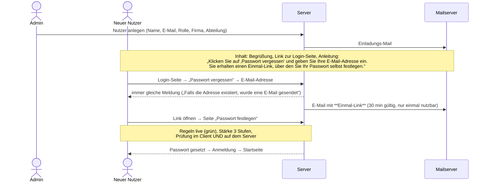

# Authentifizierung, Passwortrichtlinie und Sicherheit

Grundlage: Antworten zu F-07, N-01, N-05, N-07 (08./09.11.2026). Offene Detailfragen: N-08, N-09, R-07.

## 0. Erster Administrator (N-01, R-06 – festgelegt)

**Regel (bestätigt am 09.11.2026):** Der **erste Nutzer, der sich über `localhost` registriert**, wird automatisch **Admin**. Die Absicherung erfolgt **ausschließlich** über die localhost-Beschränkung.

- Die Ersteinrichtungsseite `/setup` ist nur erreichbar, solange die Datenbank **keinen** Nutzer enthält **und** die Anfrage von `localhost` kommt (`127.0.0.1` oder `::1`).
- Alle anderen Aufrufe von `/setup` liefern **404**, damit die Seite von außen nicht sichtbar ist.
- Bei der Ersteinrichtung legt der erste Admin auch seine **Firma** an (Name, Kürzel, E-Mail-Domain aus seiner Adresse vorbelegt, Branche, optional Logo).
- Nach der Ersteinrichtung ist `/setup` dauerhaft gesperrt (`setup_state.initialized = true`). Weitere Admins vergibt ein Admin über die Rollenzuweisung.
- Der Vorgang wird im Audit-Log mit Zeitpunkt protokolliert.

**Technische Vorgaben für die Umsetzung:**
- Geprüft wird die **tatsächliche Socket-Adresse** der Verbindung. Header wie `X-Forwarded-For`, `X-Real-IP` oder `Host` werden für diese Prüfung **ignoriert**, da sie fälschbar sind.
- **Hinweis für Phase 2 (CI/CD, Container, Reverse Proxy):** Hinter einem Proxy oder in Docker kommt jede Anfrage scheinbar vom Proxy bzw. vom Docker-Gateway, das je nach Setup ebenfalls als lokal gelten kann. Die Ersteinrichtung muss deshalb **vor** dem Freischalten über den Proxy erfolgen. Alternativ ist sie über eine Umgebungsvariable `SETUP_ENABLED=false` abschaltbar. Für den Server-Betrieb ist zusätzlich ein Konsolenbefehl `npm run create-admin` vorgesehen.

## 1. Einladung und erste Anmeldung (N-01, N-07)



**Pflichtänderung:** Weil der Nutzer sein erstes Passwort über den Einmal-Link selbst festlegt, ist es bereits sein eigenes. Eine erneute Pflichtänderung direkt danach wäre doppelt. Vorschlag (R-07): Das Setzen über den Einmal-Link gilt als „Initialpasswort ändern“. Das Flag `mustChangePassword` bleibt für Fälle bestehen, in denen ein Admin ein Passwort zurücksetzt.

**Optionale Vereinfachung (R-07):** Die Einladungs-Mail könnte direkt einen Einmal-Link (z. B. 72 h gültig) enthalten. Dann entfällt der Umweg über „Passwort vergessen“. Der Umweg wurde jedoch ausdrücklich gewünscht und ist deshalb Standard.

**Mailversand (N-05):** Standard ist der **Mailversand des Betriebssystems** (`sendmail`-Transport von Nodemailer). Im Admin-Bereich kann auf einen SMTP-Server umgestellt werden.
- Hinweis: Auf macOS und in Docker-Containern ist meist **kein Mailserver eingerichtet**. Mails gehen dann still verloren. Der Admin-Bereich bietet deshalb „Test-Mail senden“ und zeigt eine Warnung, solange kein erfolgreicher Versand bestätigt wurde.
- In Entwicklung und Test wird **Mailpit** verwendet (fängt alle Mails ab, Web-Oberfläche unter `localhost:8025`).
- Notfallweg, solange kein Versand funktioniert: Der Admin kann einen Einladungs-Link in der Oberfläche **anzeigen und kopieren**.

### 1a. Passwort-Reset durch Admin (S-01)
Der Admin löst über einen Button einen Reset aus. Das bisherige Passwort wird sofort ungültig, die Sitzungen des Nutzers werden beendet, und der Nutzer erhält einen **neuen Einmal-Link** per Mail. Der weitere Ablauf ist identisch mit „Passwort vergessen“. Hat ein Admin einer anderen Domain den Reset ausgelöst, werden die Admins der betroffenen Firma benachrichtigt.

## 2. Passwortrichtlinie (Standardwerte, im Admin-Bereich anpassbar)

| Regel | Anzeige unter dem Passwortfeld | Prüfung |
|---|---|---|
| R1 | Mindestens 6 Zeichen | `length ≥ 6` |
| R2 | Mindestens eine Zahl | `/\d/` |
| R3 | Mindestens ein Großbuchstabe | `/\p{Lu}/u` (inkl. Ä, Ö, Ü) |
| R4 | Mindestens ein Sonderzeichen | `/[^\p{L}\p{N}]/u` |
| R5 (Vorschlag) | Darf nicht die E-Mail-Adresse oder den Namen enthalten | Vergleich mit Nutzerdaten |
| R6 (Vorschlag) | Darf nicht dem bisherigen Passwort entsprechen | Hash-Vergleich |

**Darstellung:**
- Alle Regeln stehen **von Anfang an** als Liste unter dem Feld (grau, Symbol ○).
- Bei jeder Eingabe werden sie live geprüft. Eine erfüllte Regel wird **grün mit ✔** markiert, eine nicht erfüllte bleibt grau bzw. wird nach dem ersten Absenden rot.
- Die Statusänderung wird für Screenreader per `aria-live="polite"` angesagt.
- „Speichern“ ist erst aktiv, wenn **alle** Regeln erfüllt sind. Der Server prüft dieselben Regeln noch einmal, eine Umgehung über die Oberfläche ist also wirkungslos.
- Felder „Neues Passwort“ und „Wiederholen“ müssen übereinstimmen. Beide haben einen Umschalter zum Ein- und Ausblenden.

**Sicherheitshinweis:** 6 Zeichen liegen unter den gängigen Empfehlungen (BSI und NIST raten zu deutlich längeren Passwörtern). Die Mindestlänge ist deshalb im Admin-Bereich konfigurierbar; empfohlen sind 10 bis 12 Zeichen (N-09).

## 3. Stärkeanzeige (3 Stufen) inkl. Originalität

Bibliothek: **zxcvbn-ts** (`@zxcvbn-ts/core` mit deutschem und englischem Wörterbuch). Sie bewertet die **Originalität**: häufige Passwörter, Wörterbuchwörter, Namen, Tastaturmuster (`qwertz`), Wiederholungen (`aaa`), Sequenzen (`1234`), Jahreszahlen und Leetspeak (`P@ssw0rt`). Zusätzlich fließen E-Mail-Adresse, Name, Firmen- und App-Name als „verbotene Wörter“ ein.

| Stufe | Balken | Bedingung (Vorschlag) |
|---|---|---|
| **schwach** | 1/3 rot | zxcvbn-Score 0–2 (< 10⁸ Rateversuche) **oder** Richtlinie nicht vollständig erfüllt |
| **mittel** | 2/3 orange | Score 3 und Richtlinie erfüllt |
| **stark** | 3/3 grün | Score 4 und Richtlinie erfüllt |

Beispiele (gemessen mit zxcvbn-ts 3.x und deutschem + englischem Wörterbuch, 09.11.2026): `Passw0rt!`, `Qwertz1!`, `Hallo123!`, `Sommer2026!`, `Schmetterling7!` erfüllen alle Regeln, gelten aber als **schwach**; `Mustermann2026!` ist für Nutzer „Max Mustermann“ **schwach** (Bezug zu Nutzerdaten), für andere stark; `Kaffee7Mond!` = **mittel**; `Tisch7&Laterne`, `Äpfel9§Birne` = **stark**. Die ursprüngliche Zuordnung (Score 2 = mittel) wurde beim Aufsetzen des Grundgerüsts verschärft, weil sonst bekannte Muster akzeptiert worden wären. Ob ein solches Passwort trotzdem akzeptiert wird, ist Frage N-09 (Vorschlag: mindestens „mittel“ verlangen).

Die Stärke wird **zusätzlich als Text** angezeigt („Stärke: mittel“), nicht nur über die Farbe.

## 4. Sitzungen und Konto-Schutz

| Maßnahme | Vorschlag |
|---|---|
| Passwort-Hashing | Argon2id (bzw. bcrypt, Kostenfaktor ≥ 12) |
| Sitzung | serverseitige Session, Cookie `HttpOnly`, `Secure`, `SameSite=Lax`; Leerlauf-Timeout 60 min, absolut 12 h (N-08) |
| CSRF | SameSite + CSRF-Token bei zustandsändernden Anfragen |
| Brute Force | Rate Limit je IP und Konto; nach 5 Fehlversuchen 15 min Sperre |
| Benutzer-Enumeration | identische Meldungen bei „unbekannte E-Mail“ und „falsches Passwort“ |
| Reset-Links | Einmal-Token, nur Hash gespeichert, 30 min gültig, nach Nutzung ungültig |
| Audit-Log | Anmeldung, Fehlanmeldung, Passwortänderung, Admin-Änderungen |
| Transport | nur HTTPS |

## 5. Vorbereitung für SSO (später)

Die Anmeldung ist über eine **Provider-Schnittstelle** gekapselt, damit SSO später ohne Umbau ergänzt werden kann:

```
AuthProvider
├── LocalPasswordProvider   (Release 1)
└── OidcProvider            (später: Microsoft Entra ID, Keycloak, Google … via OpenID Connect)
```

- Nutzer werden intern über eine stabile `userId` geführt. Die E-Mail ist das Verknüpfungsmerkmal zur SSO-Identität (`externalId` + `provider`).
- Rollen bleiben in der App. Ein späteres Mapping auf SSO-Gruppen ist vorgesehen.
- Bibliotheken: `openid-client` bzw. Auth.js / Lucia, oder eine Identity-Lösung wie Keycloak vorschalten (ADR-005).

## 6. Firmenlogo auf der Login-Seite (mehrere Firmen, N-11, R-01 – festgelegt)

Weil mehrere Firmen die Anwendung nutzen, muss die Login-Seite **vor** der Anmeldung wissen, welches Logo sie zeigen soll. **Festgelegt (R-01):**
- **Firmenspezifische Login-Adresse** `https://<server>/login/<firmenkuerzel>` (z. B. `/login/brunata`). Sie zeigt Logo und Namen dieser Firma. Die Einladungs-Mail enthält genau diesen Link.
- Die allgemeine Adresse `/login` zeigt das **Logo des Betreibers** (konfigurierbar) bzw. ein neutrales App-Logo.
- Nach der Anmeldung erscheint in der Kopfzeile immer das Logo der Firma des Nutzers.

Technik:
- Der öffentliche Endpunkt `GET /public/branding/:firmenkuerzel` liefert nur Name, Logo-URL und Alternativtext. Für unbekannte Kürzel liefert er die neutrale Variante, damit sich keine Firmennamen erraten lassen.
- Validierung: nur `https://` (oder Upload), PNG/SVG/JPG/WebP, ≤ 1 MB. Bei Ladefehler erscheint ein **Platzhalter-Logo**.
- SVG-Uploads werden serverseitig bereinigt; die CSP `img-src` erlaubt die konfigurierten Domains.

## 7. Umsetzungsstand Phase 4a (09.11.2026)

| Thema | Umsetzung |
|---|---|
| Passwort-Hashing | Argon2id (`@node-rs/argon2`, m = 19 MiB, t = 2, p = 1); bei unbekannter E-Mail wird trotzdem gehasht (gleiche Antwortzeit) |
| Sitzung | Tabelle `session`, Token 32 Byte, in der DB nur SHA-256-Hash; Cookie `ai_tpi_session` (`HttpOnly`, `SameSite=Lax`, `Secure` per `COOKIE_SECURE`); Leerlauf 60 min, absolut 12 h |
| CSRF | `SameSite=Lax` **plus** Pflicht-Header `X-Requested-With: ai-tpi` bei POST/PUT/PATCH/DELETE auf `/api/*` (sonst 403). Ein Header kann von fremden Seiten ohne CORS-Freigabe nicht gesetzt werden – einfacher als ein Token-Verfahren, gleiche Schutzwirkung. |
| Sperre | 5 Fehlversuche → 15 min gesperrt (HTTP 429) |
| Einmal-Link | 30 min, einmalig, nur Hash gespeichert; ein neuer Link macht ältere ungültig; nach dem Setzen werden alle Sitzungen des Nutzers beendet |
| Admin-Reset | altes Passwort sofort gelöscht, Status „eingeladen“, Sitzungen beendet, neuer Link per Mail |
| Löschen | Pseudonymisierung (Name „Gelöschter Nutzer #…“, E-Mail `deleted-<id>@deleted.invalid`), Datensatz bleibt für Historie/Audit |
| Mail | Nodemailer: `smtp` (Standard, lokal Mailpit), `sendmail` (Betriebssystem), `memory` (nur Tests, Abruf über `/api/test/outbox` bei `NODE_ENV=test` + `TEST_ENDPOINTS=true`) |

**Hinweis Entwicklungsbetrieb:** Der Vite-Entwicklungsserver leitet API-Aufrufe als Proxy von `127.0.0.1` weiter. Im lokalen Entwicklungsbetrieb erscheint damit **jeder** Aufruf der Ersteinrichtung als localhost. Das ist für den lokalen Betrieb gewollt; für einen erreichbaren Server gilt Abschnitt 0 (Ersteinrichtung vor Freigabe, `SETUP_ENABLED=false`).

## 8. Umsetzungsstand Phase 4b (09.11.2026)

| Thema | Umsetzung |
|---|---|
| Firmenübergreifende Aktionen | eigene Endpunkte `/api/admin/companies`, `/api/admin/created-admins`, `/api/admin/cross-password-reset`. Zugriff auf Konten anderer Firmen **nur** auf selbst angelegte Admins (`created_by_user_id`) oder per vollständiger E-Mail-Adresse; alles andere → 404. Von anderen Firmen werden nur Name und Kürzel geliefert. |
| Reset-Limit (S-15) | höchstens 3 firmenübergreifende Resets **je handelndem Admin** und Kalendertag (Europe/Berlin); gezählt über das Audit-Log, **unbekannte Adressen zählen mit** (sonst ließe sich über das Limit die Existenz einer Adresse prüfen). Danach HTTP 429 und Audit-Eintrag. |
| Neutralität (S-14) | `POST /api/admin/cross-password-reset` antwortet für bekannte, unbekannte und inaktive Adressen gleich (202). Adressen der eigenen Firma werden abgewiesen (400), weil sie ohnehin in der Nutzerliste stehen. |
| Hinweis-Mails (S-01, S-10, S-13) | an alle **aktiven** Admins der betroffenen Firma außer dem Handelnden; Versand über den Mailserver dieser Firma. Ist der Betroffene selbst der einzige Admin, erhält er nur den Einmal-Link (der bereits sagt, dass ein Admin zurückgesetzt hat). Mailfehler brechen die Aktion nicht ab, sie werden protokolliert. |
| Geheimnisse | SMTP-Passwort und KI-API-Schlüssel AES-256-GCM-verschlüsselt (`SECRET_ENCRYPTION_KEY`, Format `v1.<iv>.<tag>.<daten>`); Antworten enthalten nur `hasPassword` bzw. `hasApiKey` + `••••<letzte 4>`. |
| KI-Verbindungstest | nur über den Server, höchstens 15 s, keine Weiterleitungen; Ergebnis `ok` / `unreachable` / `timeout` / `auth_failed` / `http_error`. Hinweis: Die Basis-URL ist bewusst auch für `localhost` und interne Adressen erlaubt (lokale Modelle wie Ollama). Da nur Admins sie setzen können und nur Status/Antwortzeit zurückgegeben werden, ist das Risiko einer Server-Side-Request-Forgery begrenzt. |
| Audit-Log | Ansicht zeigt Einträge mit `company_id` **oder** `target_company_id` der eigenen Firma (Aktionen fremder Admins sind gekennzeichnet); CSV mit `;`, UTF-8-BOM (Excel) und Schutz vor Formel-Injektion (`=`, `+`, `-`, `@` werden mit `'` entschärft). |
