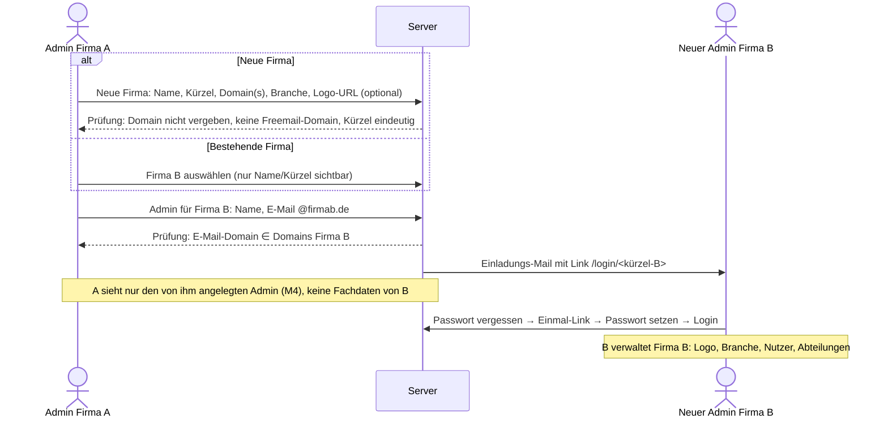

# Mandanten (Firmen), Branchen und Benchmark

Grundlage: Antworten zu N-11, R-01, R-02 (09.11.2026). Offene Detailfragen: R-03, R-04, R-05, S-01 … S-04.

## 1. Begriffe

| Begriff | Bedeutung |
|---|---|
| **Firma (Mandant)** | Organisation, deren Testprozess bewertet wird. Hat Name, **Logo**, **Branche** und eigene Assessments. |
| **Branche** | Zuordnung aus der Branchenliste (Abschnitt 4), vom Admin im Admin-Bereich gewählt. |
| **Benchmark** | Vergleich der Ergebnisse einer Firma mit (a) dem Durchschnitt **derselben Branche** und (b) **allen bewerteten Firmen**. |

## 2. Mandantentrennung und Firmen-Administration (R-02 – festgelegt)

### 2.1 Regeln
| Nr. | Regel |
|---|---|
| M1 | **Jeder Admin verwaltet seine eigene Firma**: Nutzer, Abteilungen, Logo, Branche, Domains sowie die **firmeneigene KI- und Mail-Konfiguration** (S-04). |
| M2 | **E-Mail-Domain-Bindung:** Jede Firma hat eine oder mehrere zugelassene E-Mail-Domains (z. B. `brunata.de`). Admin und alle Nutzer einer Firma müssen eine E-Mail-Adresse **dieser Domain(s)** haben. Eine Nutzeranlage mit fremder Domain wird abgewiesen. |
| M3 | **Admins für andere Firmen anlegen (S-01):** Ein Admin kann eine **neue Firma** anlegen **oder** für eine **bereits bestehende Firma** weitere Admins anlegen – jeweils mit E-Mail-Adresse der Domain dieser Firma. Der neue Admin erhält die Einladungs-Mail. |
| M4 | **Zugriff auf selbst angelegte Admins (S-01):** Der anlegende Admin behält Zugriff auf die **von ihm angelegten Admin-Konten** (Liste „Von mir angelegte Admins“): Er kann sie auf eine **Nicht-Admin-Rolle** (Assessor, Befragter, Leser) umstellen, aktiv/inaktiv setzen, Einladung erneut senden und **Passwort zurücksetzen**. |
| M4c | **Ergebnisse (S-06, S-11):** Admins dürfen die Befragungsergebnisse der **eigenen** Firma lesen. Ergebnisse **anderer** Firmen sehen sie nicht – nur die aggregierten Benchmark-Daten (eigene Firma vs. eigene Branche vs. alle Branchen). |
| M4d | **Passwort-Reset firmenübergreifend (S-10):** Admins können Passwörter von Nutzern und Admins **anderer** Firmen zurücksetzen (Eingabe der E-Mail-Adresse). Die Admins der betroffenen Firma werden per Mail informiert. |
| M4e | **Löschen von Admins (S-13):** nur durch Admins derselben Firma; die übrigen Admins der Firma werden informiert. |
| M4a | Der Schutz des **letzten aktiven Admins je Firma** gilt auch hier: Ein fremder Admin kann den letzten Admin einer Firma nicht herabstufen oder deaktivieren. |
| M4b | **Benachrichtigung (S-01, festgelegt):** Die Admins einer Firma erhalten eine E-Mail, wenn ein Admin **außerhalb ihrer Domain** Änderungen an ihren Nutzern vornimmt, weitere Admins für ihre Firma erstellt oder bestehende Admins ihrer Firma gelöscht werden. Zusätzlich Audit-Log in beiden Firmen. |
| M5 | Jeder Nutzer gehört zu **genau einer** Firma; sie ergibt sich aus der Domain seiner E-Mail-Adresse. |
| M5a | **Externe Berater (S-03, S-08)** erhalten von den **Mailserver-Administratoren** ihrer Firma eine interne Adresse mit Präfix `ext.`, z. B. `ext.max.mustermann@brunata.com`. Die Anwendung erkennt das Präfix automatisch und kennzeichnet den Nutzer als **„Extern“**; eine manuelle Konfiguration in der Anwendung gibt es nicht. |
| M6 | Eine E-Mail-Domain darf nur **einer** Firma zugeordnet sein; Freemail-Domains (gmail.com, web.de, gmx.de, outlook.com …) sind gesperrt (Vorschlag S-02). |
| M7 | Der **erste Admin** (Ersteinrichtung über localhost) legt dabei seine eigene Firma an: Name, Kürzel, Domain (vorbelegt aus seiner E-Mail-Adresse), Branche, Logo. |

### 2.2 Ablauf „Admin für neue oder bestehende Firma anlegen“

### 2.3 Technische Trennung
- Jede fachliche Tabelle (Assessment, Antwort, Kommentar, Quelle, Empfehlung, Historie, Nutzer, Abteilung) trägt eine `companyId`.
- Die Firmenzugehörigkeit wird bei **jedem** API-Aufruf serverseitig geprüft, zusätzlich über **PostgreSQL Row Level Security**. Fremde IDs liefern 404.
- **Fremde Firmen erscheinen im Benchmark nie namentlich**, nur als anonymisierte Kennzahlen.

## 3. Benchmark-Logik

### 3.1 Datengrundlage
- Pro Firma zählt das **letzte abgeschlossene** Assessment (Status „freigegeben“), damit keine halbfertigen Bewertungen in den Vergleich einfließen.
- Verglichen werden nur Assessments mit **kompatibler Katalogversion**; bei abweichenden Versionen nur die gemeinsamen Kontrollpunkte.
- Berechnet werden Kennzahlen je Kernbereich: Erfüllungsgrad (%), erreichte Ebene, KI-Index, Gesamtindex.

### 3.2 Darstellung im Bericht und in der Benchmark-Ansicht

Die Benchmark-Ansicht ist für **alle Rollen** verfügbar. Sie zeigt nur Kennzahlen je Kernbereich (Erfüllungsgrad, Ebene, KI-Index) – keine Kontrollpunkt-Antworten, Kommentare oder Empfehlungen.

| Element | Inhalt |
|---|---|
| Radar mit 3 Linien | eigene Firma · Branchendurchschnitt · Durchschnitt aller Firmen |
| Tabelle je Kernbereich | eigener Wert, Branchen-Median, Gesamt-Median, Abweichung (▲▼), Quartil |
| Rangposition | „Ihre Firma liegt im oberen 25 %-Bereich der Branche“ (Quartil statt exakter Platz) |
| KI-Reife-Vergleich | KI-Index eigene Firma vs. Branche vs. alle |
| Hinweis Stichprobe | „Vergleich basiert auf n = 7 Firmen der Branche“ |

### 3.3 Anonymität (Vorschlag, R-03)
- Ein Branchenvergleich wird erst ab **mindestens 5 Firmen** in der Branche angezeigt, sonst erscheint „Zu wenige Vergleichsdaten“. So lässt sich keine einzelne Firma zurückrechnen.
- Für den Gesamtvergleich gilt ebenfalls ein Minimum von 5 Firmen.
- Angezeigt werden Median und Quartile, keine Einzelwerte und keine Min/Max-Werte.
- Firmen können per Einstellung von der Teilnahme am Benchmark ausgeschlossen werden (Opt-out, R-04).

### 3.4 KI-Empfehlungen
Die Benchmark-Abweichungen fließen in die Priorisierung ein. Beispiel: Ein Kernbereich, der deutlich unter dem Branchen-Median liegt, wird höher priorisiert. Die KI erhält dafür nur aggregierte Werte, niemals Daten anderer Firmen.

## 4. Branchenliste (Vorschlag)

Angelehnt an die Wirtschaftszweig-Klassifikation (WZ 2008 / NACE Rev. 2), für IT- und QS-Kontext gebündelt und um IT-relevante Unterscheidungen ergänzt. Die Liste ist im Admin-Bereich erweiterbar.

| Code | Branche (DE) | Industry (EN) | NACE-Bezug |
|---|---|---|---|
| BNK | Banken und Finanzdienstleistungen | Banking & Financial Services | K 64, 66 |
| INS | Versicherungen | Insurance | K 65 |
| PUB | Öffentliche Verwaltung | Public Administration | O 84 |
| HLT | Gesundheitswesen und Pharma | Healthcare & Pharmaceuticals | Q 86–88, C 21 |
| MED | Medizintechnik | Medical Devices | C 26.6, C 32.5 |
| AUT | Automobil und Zulieferer | Automotive | C 29 |
| MAN | Maschinen- und Anlagenbau | Mechanical & Plant Engineering | C 28 |
| IND | Sonstiges verarbeitendes Gewerbe / Industrie | Other Manufacturing | C (sonstige) |
| CHE | Chemie und Prozessindustrie | Chemicals & Process Industry | C 20 |
| ENE | Energieversorgung und Versorgungswirtschaft | Energy & Utilities | D 35, E 36–39 |
| RES | Immobilien- und Wohnungswirtschaft, Messdienste | Real Estate, Housing & Metering Services | L 68, N 81 |
| CON | Bauwirtschaft | Construction | F 41–43 |
| TRA | Transport, Logistik und Verkehr | Transport & Logistics | H 49–53 |
| AER | Luft- und Raumfahrt, Verteidigung | Aerospace & Defence | C 30.3, C 25.4 |
| RET | Handel und E-Commerce | Retail & E-Commerce | G 45–47 |
| TEL | Telekommunikation | Telecommunications | J 61 |
| ITS | IT-Dienstleistungen und Beratung | IT Services & Consulting | J 62, M 70 |
| SWP | Softwarehersteller (Produkte, SaaS) | Software Vendors & SaaS | J 58.2, J 62.01 |
| MDA | Medien, Verlage und Unterhaltung | Media, Publishing & Entertainment | J 58–60, R 90–93 |
| HOS | Tourismus, Gastgewerbe und Freizeit | Tourism, Hospitality & Leisure | I 55–56, N 79 |
| EDU | Bildung und Forschung | Education & Research | P 85, M 72 |
| AGR | Land- und Forstwirtschaft, Lebensmittel | Agriculture & Food | A 01–03, C 10–11 |
| PRO | Freiberufliche und technische Dienstleistungen | Professional & Technical Services | M 69–74 |
| NGO | Non-Profit, Verbände und Kirchen | Non-Profit & Associations | S 94 |
| OTH | Sonstige | Other | – |

Hinweis: Die Branche „Immobilien- und Wohnungswirtschaft, Messdienste“ schließt Abrechnungsdienstleister wie BRUNATA ein. Ist eine feinere Unterteilung gewünscht, z. B. nach Unternehmensgröße (KMU / Mittelstand / Konzern) als zweite Vergleichsdimension, siehe R-05.
